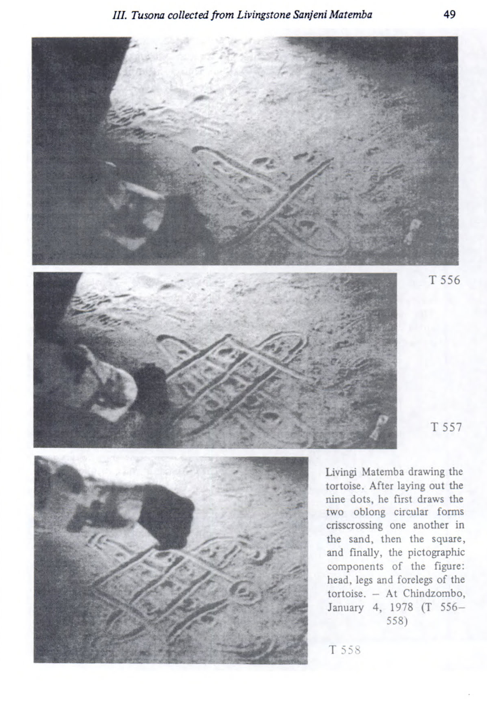
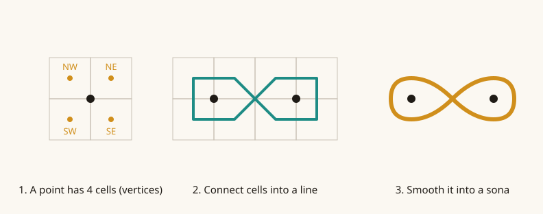
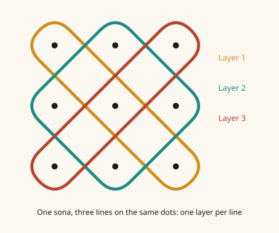
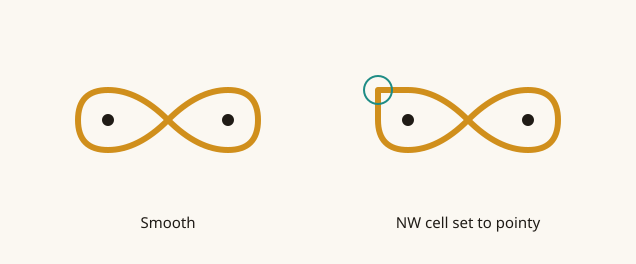
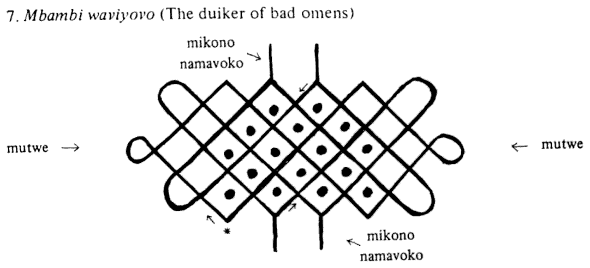
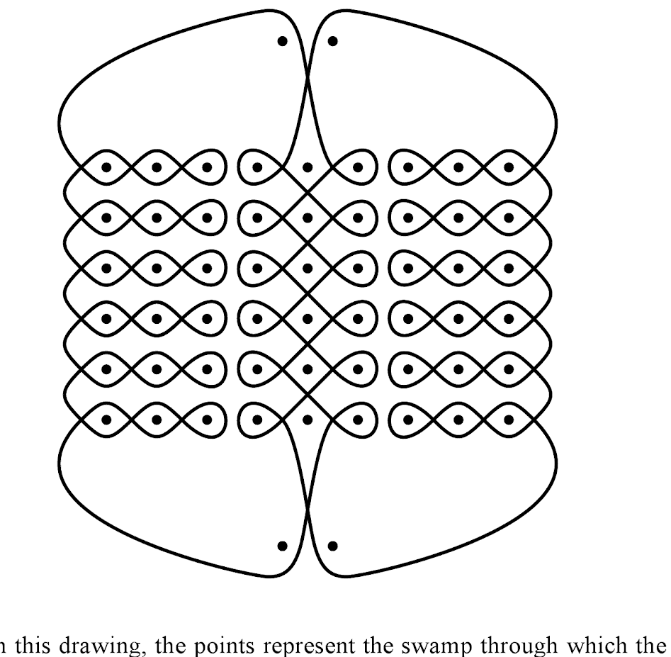
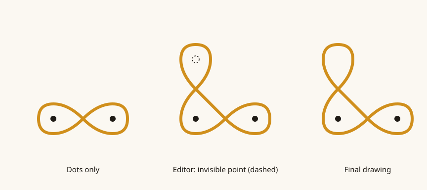

# Sikku-Kolam / Sona app: dev notes

## The problem with existing apps

Most Sikku Kolams apps that I have seen have limitations:

- **They use planar graphs.** This means the user cannot dynamically draw the sona in the way that is normally done traditionally, instead "connecting" the dots. I understand why most programmers chose planar graphs to represent kolams as it makes things more simple, but that representation inherently stops you from unleashing the artistic potential of kolams/lusona.
- **They do not integrate an automatic animation.** This is unfortunate as
- **They do not offer the option to translate an image or photo** to a digital kolam in the app.
- **No share features**, no "social media" like utility for people to share their creations.

*Livingi Matemba drawing a tortoise sona in the sand, 1978. From Gerhard Kubik, Tusona: Luchazi Ideographs.*

This is unfortunate. Sona/Sikku Kolams are traditions that fascinate me, and I believe in using technology to perpetuate or even further tradition is the way to go!

To fix this gap, I have decided to make my own app.

## Directed graphs instead of planar graphs

Instead of planar graphs, I decided instead to use directed graphs. A "point" can be separated into 4 vertices. Vertices can connect to each other, which results to a drawing:

## Layers

To enable multi-linearity, there are "layers":

## Pointy edges

An advantage of this implementation is that one can tweak the edges more creatively. For example, you can select a vertice and ask that whatever edge there is there, be "pointy":

## Scanning, offline

My program also enables the user to scan a sikku kolam. To achieve this, I decided to train a TensorFlow Lite model that is shipped with the app. I understand a lot of users will probably be from third world countries and access to utilities offline is appreciated. I say that as someone that grew up in the third world as well! Users might want to scan a sona and have slow or unavailable internet, or even limited data.

## Stories

This program focuses more-so on the Tusona tradition of Angola than on Indian Sikku Kolam. Hence, there is also the integration of proverbs, stories, and explanations, even with a voice over!

*Mbambi waviyovo (the duiker of bad omens). Every part has a name: mutwe (heads), mikono namavoko (legs). From Kubik, Tusona.*

## Sharing

Finally, users can share each others' creations on the platform in a sort of reddit-like forum. The most appreciated drawings will receive more upvotes:

## Problem: curves outside the points

I faced a problem though. In some sona drawings, there are arbitrary curves outside of the scope of the points.

For example with this one:

*The stork and the leopard. The points are the swamp the stork ran through. From Paulus Gerdes, Drawings from Angola.*

### Invisible points

To solve this, I decided to add the option of adding invisible points that simply describe curvatures:

Possible implementations:

1. Invisible points are added by the user manually.
2. We stick to the TensorFlow recognition, and when the user draws outside of the scope of any point, the curve is identified and "invisible" points added automatically.

---

# Later notes (2025–2026)

## Animation ideas

| Idea              | What happens                                                                      |
| ----------------- | --------------------------------------------------------------------------------- |
| Genesis story     | A lightning bolt or star flies through a 3D cosmos, constructing the pattern.     |
| Brush painting    | An expressive, Chinese-brush-like stroke traces the line.                         |
| Bouncing ball     | A ball ricochets around obstacles, leaving the pattern as its trail.              |
| Shader art        | Luminous or psychedelic procedural effects reveal and transform the drawing.      |
| Archer            | An arrow is fired and ricochets along the curve.                                  |
| Archer deity      | A mythological archer fires a projectile that orbits planets.                     |
| Mole              | A mole digs tunnels in the shape of the pattern.                                  |
| Simon the Digger  | A Gurren Lagann-style drill carves the path, with particles and debris.           |
| Trippy visuals    | Abstract distortions and audiovisual experiments.                                 |
| Serpent           | A snake travels around the points and leaves the pattern behind.                  |
| Ouroboros         | A snake hatches from an egg, traces a single closed line, then eats its own tail. |
| Galactic Rayquaza | A cosmic dragon orbits planets along the design.                                  |

Almost all of them are the same thing: **something travels along the sona's path in drawing order and leaves the line behind.** The animation doesn't have to *simulate* its way to a valid sona. The arrow can follow the precomputed path while the scene makes it look like it's bouncing off planets.

## Editor features wanted
- Placing dots on a grid, in a diamond arrangement, or one at a time anywhere.
- Symmetry tools.
- Invisible points.
- Erasing.
- Touch gestures.
- Adjustable curvature.
- Save and load.
- Undo and redo.
- Multiple lines.
- Stories with text, voice-over (TTS) and timing.

## Design thoughts from the old code comments
- **All layers share the same points and cells; only their connections differ.** Don't duplicate the points per layer.
- **The pattern has no business deciding how layers interact.** It just represents the pattern.
- **"Who holds the color and thickness of the line?"** Not the pattern. Styles (color, width, symbols, backgrounds) belong to a separate *drawing* layer on top of the pattern, and they should be stored in a portable way, not as Flutter objects. Drawings may also contain symbols and other elements that aren't part of the sona itself.

---

## Sources

- Paulus Gerdes, *Drawings from Angola: Living Mathematics* (2007).
- Gerhard Kubik, *Tusona: Luchazi Ideographs. A Graphic Tradition of West-Central Africa*, 2nd ed. (LIT Verlag, 2006).
