# Edge cases

Patterns that break naive models. The format has to hold every one of these before it's called done. One entry per pattern: the image, what it breaks, and the current answer (or "open").

Add to this as you find more. A good edge case is one where you can say *exactly* which part of the model it stresses.

## Multilinearity

### Dos Santos, Fig. 324 and Fig. 325: same dots, different lines
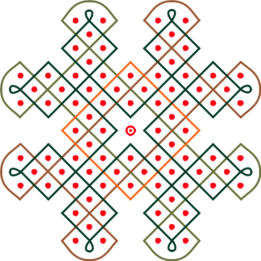 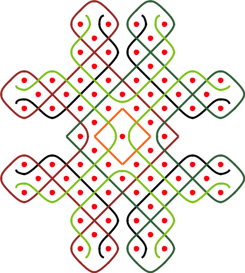

*Gerdes, Geometria Sona de Angola, after Dos Santos pp. 57–58.*

- **Same dot layout, two completely different decompositions into lines.** The dots don't determine the lines, so the route has to be stored and can't be derived with a pattern/algorithm all the time.
- **Lines of very different lengths share the grid**
- **324 mixes straight diagonals with curved caps in one line**: shape changes per segment, inside a single line.
- **Tiny curls between two dots** (324, top/bottom and side tips): the line makes a small self-loop that goes around *no* dot.
- **S-shaped snakes with free ends** (325): lines that wind between rows instead of crossing diagonally, and stop with a curl. The waypoints are dots, but the shape between them is a deliberate wave, and the line is open.
- **A marked dot** (324, centre: a dot with a ring): the dot itself is drawn differently. That's a symbol or style on a dot, not a line.
- **4-fold symmetry**: you'd want to shape one quarter and have the rest follow.
- **Not every line is a loop** (325): some lines start and end without the start joining the end again.

**Current answer:** routes are stored (not derived). Per-segment shapes handle the straight/curved mix. Curls are a connection shape (see "Self-loops" below). Open: how a symmetry is declared.

### Pearson, Fig. 326: *ndzango ya makisi* (the council of the dancers)
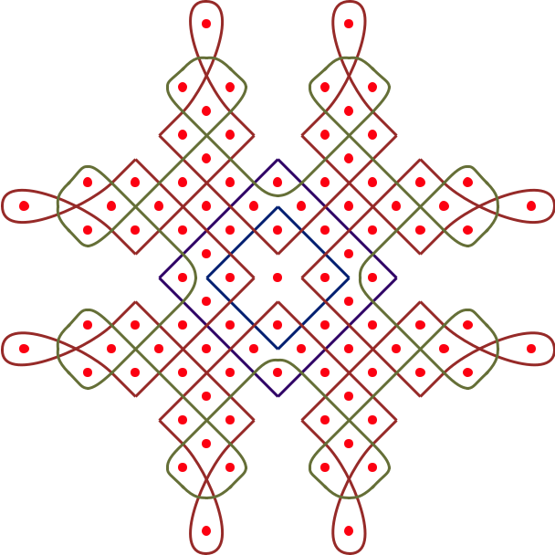

*Gerdes, Geometria Sona de Angola, after Pearson p. 99.*

- **Teardrop petals reaching far outside the grid**, each around a single outlying dot, crossing themselves at the neck.
- **Nested squares in the centre**: two dark-blue diamonds, one inside the other, that never cross each other (they do cross the red and green lines).
- **Smooth bumps inside a straight weave**: the green line runs in straight diagonals but rounds over a dot in a soft arc at four spots near the centre.

**Current answer:** petals are a route around one dot plus an "elongated" shape (or an invisible anchor at the tip). Nested squares are just two routes. Bumps are a per-segment shape change.

### Pearson, Fig. 327: *makisi a VaMbunda* (the Mbunda dancers)
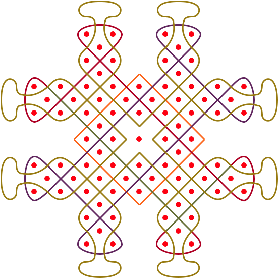

*Gerdes, Geometria Sona de Angola, after Pearson p. 100. Same layout as Fig. 326, different drawing.*

- **Hammer-head caps with no dots inside at all**: the gold line leaves the grid, draws a flat cap with straight sides and rounded corners, and comes back. Pure aesthetic shape, nothing to anchor it.
- Same dot layout as Fig. 326, drawn with different lines: the same lesson as 324/325.

**Current answer:** open. Invisible anchors at the cap corners plus `rounded-corner` segments would work, but it's a lot of points for one shape. A good test for parametric shapes or tangent handles.

## Shapes not bound to points

See "Shaping curves that no point dictates" in [Reflections.md](Reflections.md) for the options.

### Big curves far from any dot
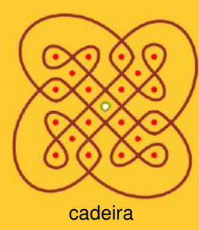
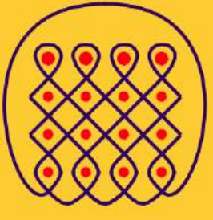
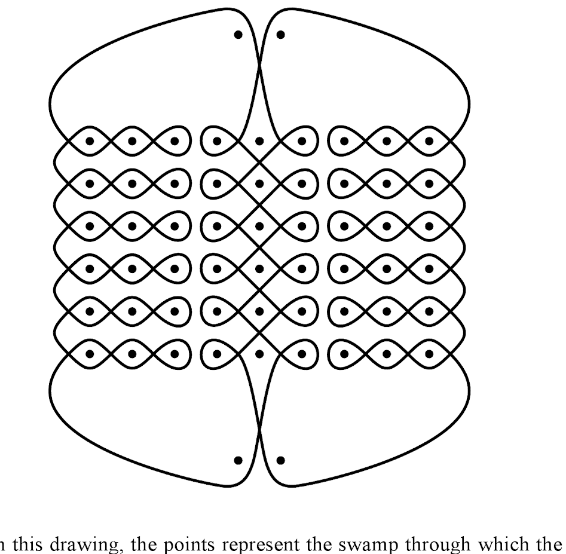

### Caps with no dot dictating them
Fig. 327: a hammer-head cap with no dots inside.

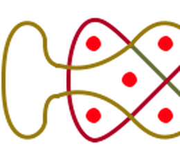

Fig. 324: an arched cap, straight sides flaring out to a rounded top, over two dots.

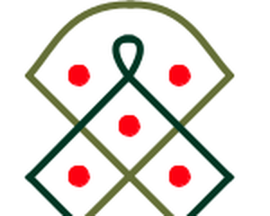

### Tapered tips
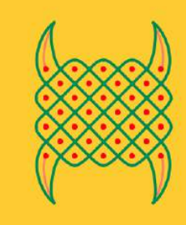
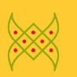

### Straight runs with chosen corner styles
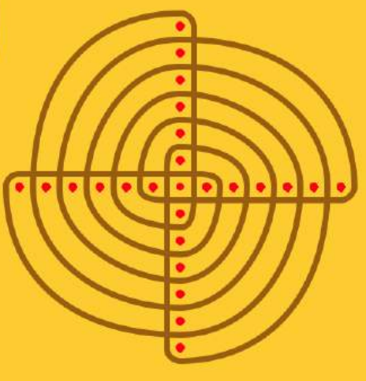
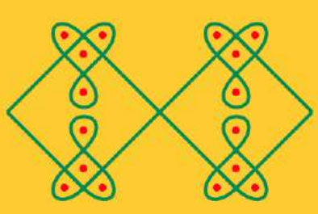

### Waves between dots
Fig. 325: the green and black lines wave between the dots, and **they end**: free curled ends inside the frame. Open strokes in a geometric sona, not just in figurative ones.

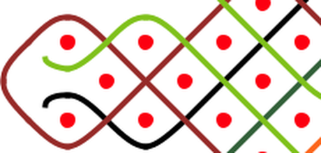

## Self-loops

Rule: **a loop with no dot inside is a shape; a loop with a dot inside is route.**

Fig. 324, the tip: a small loop around nothing (same crop as the cap above). **Answer:** a normal connection between two neighbouring cells, with the `curl` shape (size, side). The loop's self-crossing is not a route crossing.

Fig. 326, the petal: a loop around one far dot, crossing itself at the neck. **Answer:** route. It visits the far dot's cells, and the neck crossing is a real crossing.

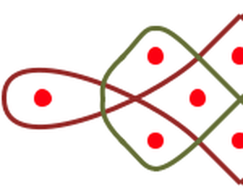

## Open strokes and figurative parts

### Legs, heads, tails: lines with ends
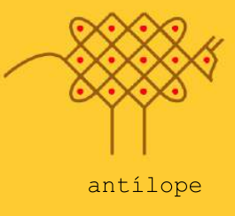
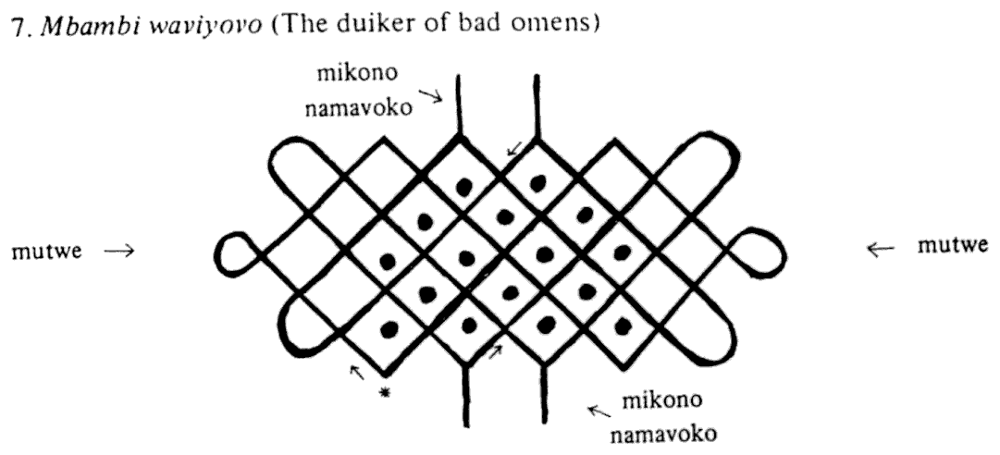

### Straight bars inside frames
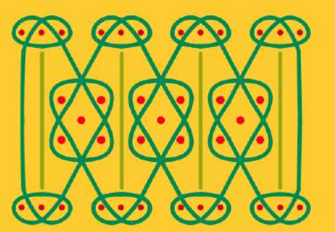

## Lines on dots, auxiliary lines, junctions

Found by the edge-case miner (November 2026) and checked against the images and Gerdes' own text.

### Gerdes' auxiliary lines are drawn, not hidden
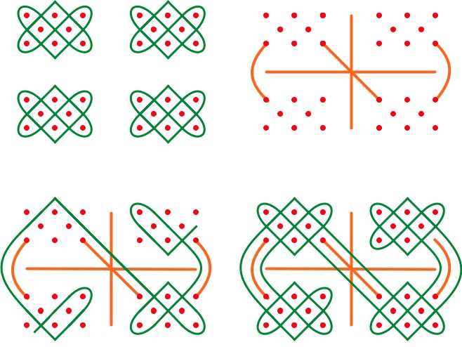
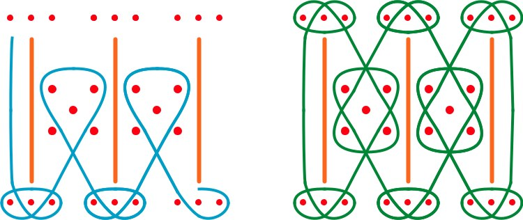

*Gerdes, Geometria Sona de Angola. Fig. 198 after Fontinha p. 143; Fig. 122 after Fontinha p. 279.*

- Gerdes calls them *linhas* / *segmentos auxiliares* and leaves them out of the line count: "monolinear, not counting the auxiliary lines". But they **stay in the finished drawing**.
- Fig. 198: (a) four separate mat patterns, (b) dots plus orange lines joining "the points to be merged", (c) the line wraps around the orange lines, (d) the final drawing, orange lines still there. Gerdes: the auxiliary lines "make the drawing much easier to execute".
- Fig. 122: vertical lines "drawn in advance" (*traçadas de antemão*), and the line weaves around them.
- The word covers two things: **walls** the line wraps around (Figs. 122, 198, 260, the bars in 93), and **figurative extras** (Fig. 254: "arms, legs, eyes, mouth"; Fig. 65: porcupine spines "added at the end").
- A wall between two dots that the line can't cross is exactly a **mirror** in the Gerdes/Jablan mirror-curve model (the same idea as `prior_work/portfolio_scheme/structure_lusona_graph.png`).

**Current answer:** an auxiliary line is an ordinary path with role `auxiliary`: visible, not counted in linearity, usually first in the drawing order. Main-line vertices next to it can be bound as "goes around this path", the same way they're bound to a dot's cells. Not a hidden construction layer.

### Lines through dots and ending on dots
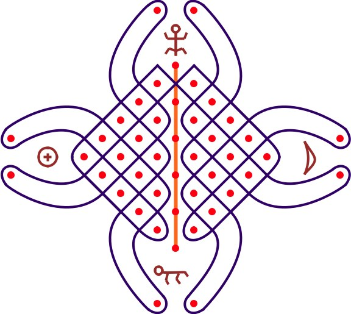
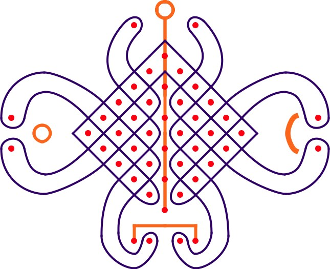
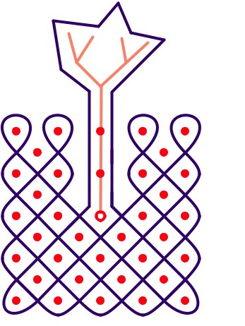
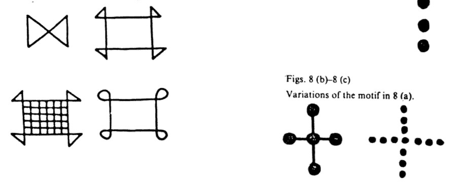

*Fig. 173: nzambi / kalunga, God (Fontinha p. 177; Hamelberger p. 329). Fig. 174a: probably Pearson's ku-tanga, creation (p. 25); the miner mislabelled it as Fig. 173. Fig. 91a: Dos Santos p. 103. Kubik, Tusona p. 239, after Mubitana 1970.*

Two different things look alike here:
- **Walls through a dot column.** In Figs. 173/174a, the line in the central column runs through every dot, and the woven line **never crosses it**: it turns back on both sides, its corners touching it at the top. It's an auxiliary wall (above), not a stroke woven through dots.
- **Strokes that really sit on dots.** Fig. 91a: a stroke starts at a ringed dot, runs through two dots and branches into a tree. Kubik/Mubitana Fig. 8(b): a plus sign with big dots at the centre and arm ends; the dots are characters (duiker, dog, man).

**Current answer:** already in Design v2: a vertex can be bound to a dot's centre. Doesn't break the model.

### T-junctions and branching
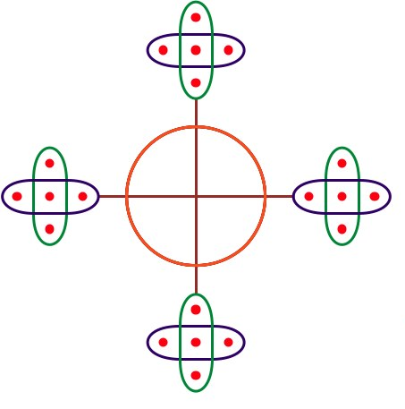
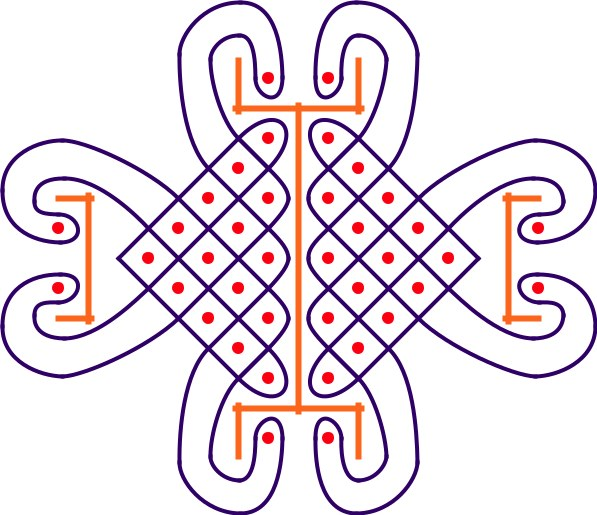

*Fig. 138 and Fig. 174b (Pearson's lihangununo, p. 26).*

- Fig. 138: the bars run from the circle and end exactly on the loops: no crossing, no corner.
- Fig. 174b: auxiliary I-beams, made of T-junctions.
- Fig. 91a (above): a stroke that forks into a Y with twigs.

**Current answer:** v2's "vertex bound to a point on another path". A tree is several open paths starting from the same junction vertex. No new primitive.

### Standalone glyphs
Fig. 173 (above): four small pictographs (a figure, a circle with a cross, a crescent, a creature) in the empty bays, part of the recorded drawing, not of the woven line. Kubik p. 239 (above): Mubitana's *chingelengele* glyphs (no dots, arrowhead and hook ends). Kubik notes they use different graphemes from the tusona tradition.

**Current answer:** small paths on the symbols layer, each with an optional label/meaning so the story can point at them.

## Presentation

### Over/under at crossings
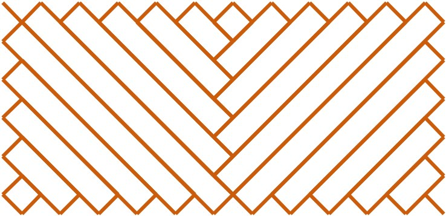
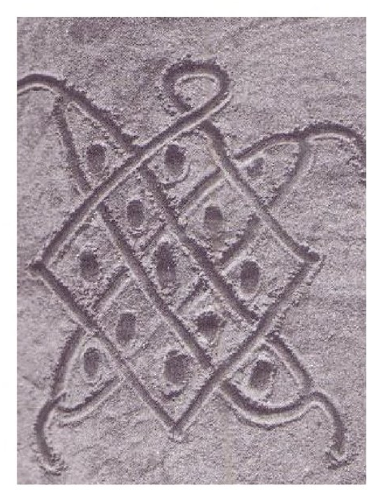
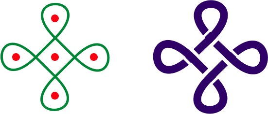

*Fig. 56: Torday & Joyce p. 198 (Bushongo). Tortoise: Gerdes, Drawings from Angola p. 16. Fig. 317b: Redinha's rock engraving at Capelo, Alto-Zambeze.*

- **In sand, the last stroke wins.** Gerdes on Fig. 56: drawn fast in fine sand, "only the segments traced last at each place stay visible". The tortoise photo: "it is easy to discern which of the three independent closed lines was traced first."
- **Engraved interlace:** Fig. 317b is the same motif as 317a, cut into rock as a ribbon with over/under breaks, and no dots.

**Current answer:** in sand, "on top" falls out of the drawing order (later on top), so it isn't stored. An optional per-crossing override in presentation, for interlace styles like 317b.

### A locally denser dot column
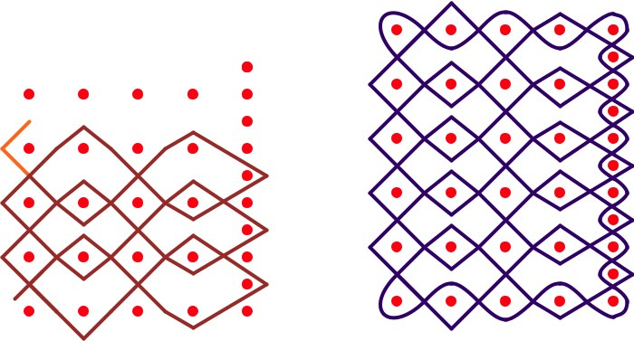

*Fig. 126: lihina, a blanket of bark (Pearson p. 137). Fig. 125: its construction.*

Gerdes: "additional points in the last column". The right column has dots at half spacing, and the line wiggles tightly between them.

**Current answer:** free dot positions already hold it. **Spec detail:** a cell's position can't be one global offset from its dot, or neighbouring cells collide in the dense column. Cell geometry follows local spacing (or is stored per dot).

### Decorations: line ends and segments
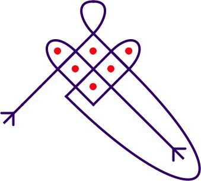
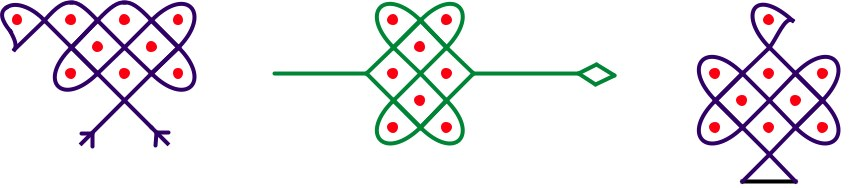
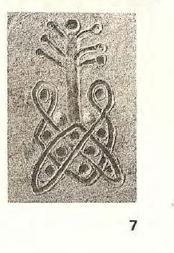
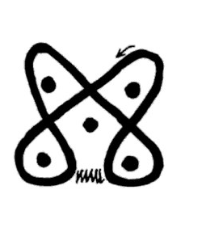

*Fig. 165: Fontinha p. 157. Fig. 39: Fontinha / Pearson. Sand photo: Gerdes, Desenhos da África p. 7. Kubik, Tusona p. 38: limba lyavamphembe, the pen of goats.*

- End caps: arrow fletching (Fig. 165), forks, a diamond tip, a triangle foot (Fig. 39), knobs on branch ends (the sand photo).
- *Hambelo*: a normal closed pattern with a decoration. The zigzag is the log barring the pen's entrance (the story ends on it: *kelekeche!*). It sits where one connection of the route would be: the route stays the same, and that connection is drawn as a zigzag. Same family as tails and fangs.

**Current answer:** end caps on open paths from a small list (arrow, fork, knob, diamond, triangle, hook), plus a **segment style** (e.g. `zigzag`) for decorations that replace a connection. Anything not on the list can be drawn as small paths. Forked feet are a cap, not branching.

## Variants and provenance

### Recorded vs reconstructed, one drawing with several meanings
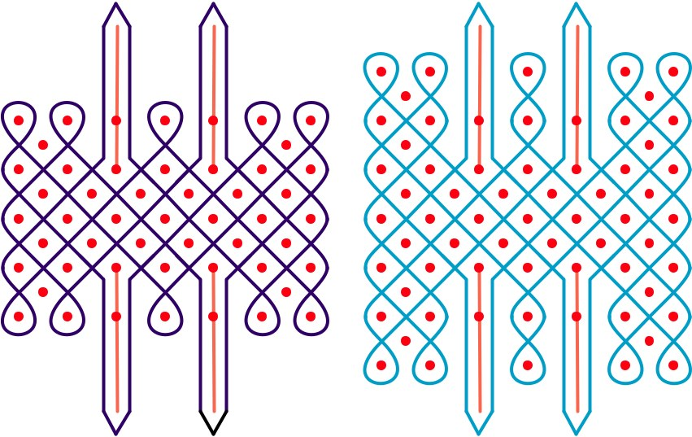
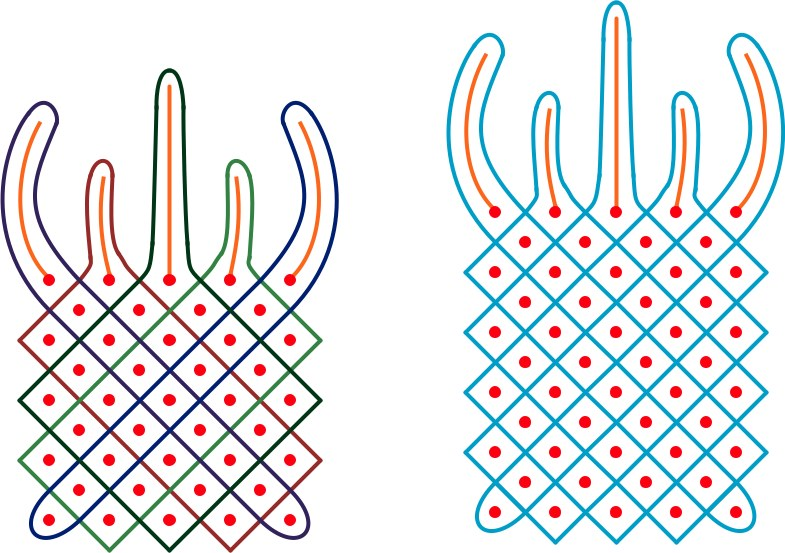

*Fig. 93: Fontinha p. 251; Fig. 94: Gerdes' reconstruction. Fig. 260: mutwe wa djamba, the head of an elephant (Fontinha p. 167); Fig. 261: Gerdes' alternative.*

- Fig. 93/94: "I have the impression it isn't the original version… I built Fig. 94, which seems to me the original version."
- Fig. 260/261: 5-linear as recorded; Gerdes' 6×5 alternative is monolinear. "Perhaps one of these alternatives was the original lusona."
- Fig. 318: the same drawing recorded by Hamelberger, Dos Santos and Fontinha with **three different meanings** (a heap of grass for thatching, a tick-bird's nest, a rodent's bed).

**Current answer:** file metadata, not drawing content: a list of sources, each with its own name and meaning, plus relations (`reconstructed_from`, `variant_of`).

### To check: a gap in the palisaded village
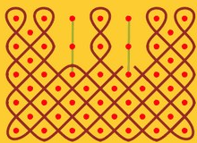

*Gerdes, Lusona: Recreações Geométricas, "traditional sona" page (povoação defendida por paliçadas, probably).* The right bar sits in a real gap in the line. Gate, or rendering slip? Unconfirmed.

## Out of scope

Textures drawn with several fingers at once.

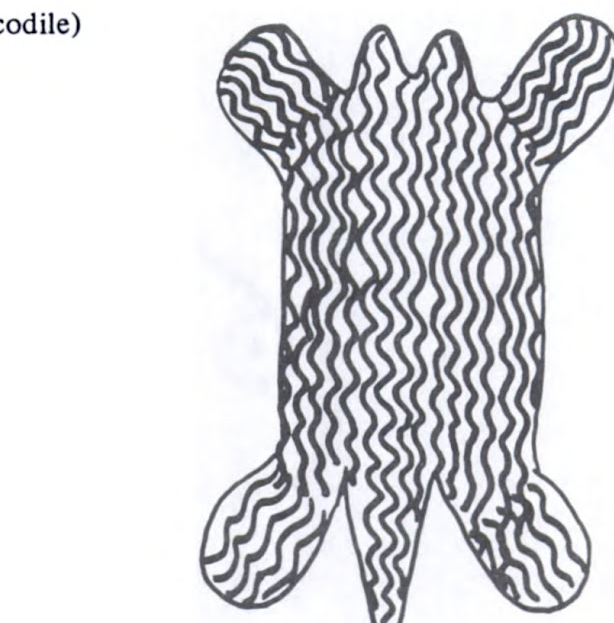
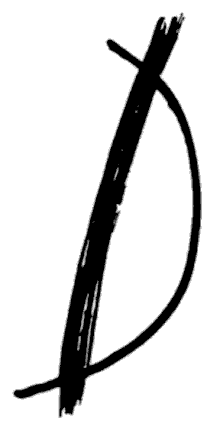

## To find

- [x] A line that **passes through a dot** instead of around it: yes, see "Lines through dots".
- [ ] Two lines that **touch without crossing** (tangent).
- [ ] A drawing where the **order of drawing changes the meaning** or the story (Kubik).
- [x] Dots that belong to **no line** (characters): the hunter and dog, Mubitana's duiker, dog and man (Kubik p. 239).
- [ ] Very **irregular dot layouts** (not a grid at all).
