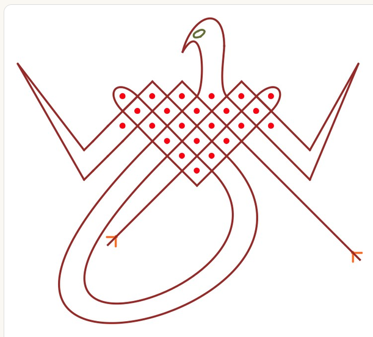

# Reflections

Thinking out loud as LusonaCreator restarts (November 2026). The 2024 design is in [Blog_draft.md](Blog_draft.md).

## Why this is hard

Sona are part system, part freehand. 
A lot of a drawing follows rules (dots, cells, crossings, the line weaving around points), but parts of it are free with big sweeping curves, horns, legs, heads, sharp tips. 

A format that only knows dots and smooth curves can't hold the real corpus. A format that's pure freehand loses everything that makes sona sona: what the line goes around, the order it's drawn in, and where the story happens.

## Method: design from the hardest cases

Last time the model was built from the simplest sona and extended with add-ons as harder ones showed up, which is a poor approach.

This time it goes the other way: collect the most limiting patterns first ([EdgeCases.md](EdgeCases.md)), define the constraints they impose, and design the minimum-viable-most-generalizable model that holds all of them from the start. 
The simple cases then fall out as specially dumb cases instead of being the foundation everything else gets bolted onto.

**Finding the hard cases: LLM reconnaissance.** Reading every figure in every source by hand doesn't scale, so `tools/edge_cases/` (developed by Claude, to be used by Claude(recursive huh)) extracts every figure and page from `sources/` (1,283 units), has a cheap model (Haiku) screen out pages with no sona (750 left), and has a strong model (Opus) flag what each drawing would break in the *basic naive* model, which it reads from this file and EdgeCases.md. 
Every claim comes with a bounding box, and the gallery shows the crop, so one can confirm or reject it in seconds.

## What the real corpus throws at the model

| What happens | Examples | What the model needs |
|---|---|---|
| Regular weaving around dots | [regular grid](images/examples/regular_grid.png), [patas de antílope](images/examples/patas_de_antilope.png), [hunter and dog](images/sources/gerdes_hunter_and_dog.png) | Cells + smoothing. The easy part |
| Big sweeping curves far from any dot | [cadeira](images/examples/cadeira.png), [dome over grid](images/examples/dome_over_grid.png), [side wings](images/examples/side_wings.png), [large ellipses](images/examples/large_ellipses.png), [double heart wings](images/examples/double_heart_wings.png), [stork and leopard](images/sources/gerdes_stork_and_leopard.png), [Mukanda](images/sources/kubik_mukanda.png) | **Invisible points** as anchors for the shape |
| Shapes that aren't smooth curves | [horns](images/examples/horns.png), [leaf tips](images/examples/leaf_tips.png), [vine](images/examples/vine_triangle_top.png) (triangle top, curved tail), [spiral arms](images/examples/spiral_arms.png) (straight arms, rounded corners), [diamond wings](images/examples/diamond_wings.png) | Edge shapes beyond Bézier: straight / rough, rounded-corner, horn |
| Figurative parts that aren't the woven line | [antelope](images/examples/antelope_figurative.png) (legs, neck, tail), [frames with bars](images/examples/frames_with_bars.png), [Mbambi the duiker](images/sources/kubik_mbambi_duiker.png) (legs, two heads) | Open strokes that start and end, separate from the closed loop |
| Lines that wander between groups | [separated blocks with an outer loop](images/examples/separated_blocks_outer_loop.png) | Same route model; the line just visits several dot groups |
| Not dot-based at all | [Ngandu the crocodile](images/sources/kubik_ngandu_crocodile.png): drawn with **four fingers at once**, so every stroke is four parallel wavy lines. [Chikuta changendzi](images/sources/kubik_chikuta_changendzi.png): a thin one-finger line crossed by a thick two-finger line | **Out of scope.** These are drawing techniques, not line structures. At most, a line can have a thickness |

Invisible points + rough edges handle a lot. For example [Diamond wings](images/examples/diamond_wings.png) is just invisible points with edges set to rough.

## Design v2: bound and free vertices (supersedes parts of the sections below)

November 2026, after the edge-case mining. 
The earlier design kept adding features: invisible points, anchor kinds, shape types (horn, curl, cap, wave). The hard cases ([bird with the long neck](images/examples/bird_long_neck.png), [bird with legs](images/examples/bird_triangle_legs.png), [butterfly](images/examples/butterfly.png), [X with hooks](images/examples/x_long_diagonals_hooks.png), [pinwheel](images/examples/pinwheel_irregular_dots.png), [two blocks](images/examples/two_blocks_sweeping_curves.png), [grid with a cut](images/examples/grid_with_cut.png)) say: stop adding features and make the base general.

**A sona is a set of paths. A path is a sequence of vertices. Each vertex is either:**
- **bound** to something meaningful: a dot's cell (NW/NE/SE/SW), a dot's centre, or a point on another path (T-junctions, legs growing out of a body); or
- **free**: just x, y. This is done with a "bag of invisible points", hidden from the user. In the editor they're just how you drag a curve, like the points in a font.

**Gerdes got there first.** In *Geometria Sona de Angola* he shows auxiliary lines (his *linhas* / *segmentos auxiliares*, in orange) that the sona line wraps around. They're **drawn and stay in the finished drawing** (Fig. 198d; Fig. 122: "drawn in advance"), but he leaves them out of the line count. So: **a thing the line goes around can be a point or a segment.** A wall between two dots that the line can't cross is a mirror in the mirror-curve model. In this model, an auxiliary line is an ordinary path with role `auxiliary` (visible, not counted, usually drawn first), and the vertices that wrap it can be bound to it, the way they're bound to a dot's cells. See [EdgeCases.md](EdgeCases.md), "Gerdes' auxiliary lines are drawn, not hidden".

**Each segment between two vertices** is `auto` (the smooth default, computed from its neighbours), `straight`, or a curve with explicit handles.

Everything else is **presentation**: dot style (ring, leaf, glyph, size), segment style (colour, thickness, stroke technique), end caps on open paths (arrowheads, forked feet, hooks), which line is on top at a crossing. And **layers** by kind: lines (including Gerdes' auxiliary lines: visible, not counted), construction (editor-only guides, hidden), symbols, annotations/labels, timeline (drawing order, start points), reference photo. Relations between drawings (recorded vs reconstructed, derived from) are file metadata, not drawing content!

**Consequences:**
- **Shape types become editor tools, not format concepts.** Horn, curl, cap and wave are tools that *write* vertices and handles. The format never needs a new type for a new shape. A segment can keep an optional tag (`made_with: curl(size=…)`) so it stays editable as a curl; a program that doesn't know the tag still draws it from the stored points.
- **The grid is presentation too.** Dots are free positions, each with its own four cells. The grid is only editor snapping, so the denser dot column and irregular layouts aren't special.
- **The meaning lives in the bound vertices**: what the line goes around, in what order, where it crosses. Animation, stories and scanning read those. Free vertices carry the art. Every drawing has a measurable bound/free split, so meaning never gets lost in decoration.
- **Freehand is fine as long as it's points.** A handful of discrete, editable, animatable free vertices is not the bad kind of freehand; an unstructured scribble would be. The route stays structured.

**Format generality is not generator generality.** The format must *hold* anything; that's bound + free vertices. A generator (mirror curves, plaited mats, Gerdes' chaining rules) only has to *produce* the woven parts. The bird's neck isn't produced by any rule: it's an artist's decision, and the format just stores it.

**Checked against the hard examples:**

| Drawing | How it's held |
|---|---|
| [Bird, long neck](images/examples/bird_long_neck.png) | Body bound; neck, zigzag arms, tail loop free; arrow ends are end caps; eye is a tiny path or a symbol |
| [Bird, triangle](images/examples/bird_triangle_legs.png) | Legs: open paths starting from a vertex bound to a point on the triangle; forked end caps. Wings free |
| [Butterfly](images/examples/butterfly.png) | Wing outline: its own path of free vertices. Heart weaves bound. Small circles: tiny paths or dot style |
| [X with hooks](images/examples/x_long_diagonals_hooks.png) | Diagonals straight to free corner vertices; hooks are end caps; the bottom teardrop has no dot inside, so it's segment shape |
| [Grid with a cut](images/examples/grid_with_cut.png) | A crossing replaced by two turn-backs: a different route, still bound. Ringed column: dot style |
| [Two blocks](images/examples/two_blocks_sweeping_curves.png) | Blocks bound; the sweeping curves between them run through free vertices |
| [Pinwheel](images/examples/pinwheel_irregular_dots.png) | Dots at free positions; arms end on dot centres; kite tips are free vertices with straight segments; ringed centre: dot style |
| [Four-dot knot](images/examples/four_dot_knot.png) | Dots at free positions, loops bound to their cells |

What still needs real thought: the editor UX for binding and unbinding vertices, and how scanning decides bound vs free (probably: near a dot's cell, bound; otherwise free).

## Design: route + shape, per line

Every line has two layers.

**1. Route (topology).** The ordered list of waypoints the line passes: a dot's cell (NW / NE / SE / SW) or an invisible anchor, plus the crossings. This is the *meaning* of the drawing: what it goes around, and in what order. Animation, storytelling and scanning all read this layer.

**2. Shape (geometry), per segment.** Each stretch between two waypoints has a shape type with parameters:
- `smooth`: B-spline default (cell centres as control points);
- `straight` / `rough`: sharp corners, straight runs;
- `rounded-corner`: straight with a corner radius (spiral arms);
- `horn`: tapered spike with direction, length, curl;
- `freehand`: raw Bézier control points stored as-is. The escape hatch, so **anything** can be represented even when no rule fits.

**Modularity:** a new shape is a new segment type. Old files keep working; a generator that doesn't know a shape falls back to `smooth`.

**Lines can be closed loops or open strokes.** Legs, necks, bars and tails are open strokes.

**Out of scope: textured tusona like Ngandu.** Kubik shows some tusona that aren't dot-and-line drawings at all (four-finger wavy textures, trembling-hand lines). They're a different kind of drawing, so the format doesn't try to cover them. A per-line thickness is the most it needs.

## What Kubik adds that Gerdes doesn't

Gerdes is about the geometry. Kubik (*Tusona: Luchazi Ideographs*, scans in `sources/scans/`) recorded **how real people drew them**, in the field in the 1970s, with photos:
- **Drawing order is part of the drawing.** For [the tortoise](images/sources/kubik_drawing_tortoise_in_sand.png), Livingi Matemba lays out the nine dots, first draws two oblong forms crisscrossing each other, then the square, then the pictographic parts: head, legs, forelegs. The format must store the order of lines *and* of parts, not just the final picture.
- **Start points and direction are marked.** Mbambi has an asterisk where the line starts and arrows for the direction.
- **Parts have names and meanings.** Mbambi: *mutwe* (heads), *mikono namavoko* (hind legs and forelegs). Mukanda: *vilombola* (guardians), *tundanda* (initiates). Even single dots are characters: in [the hunter and the dog](images/sources/gerdes_hunter_and_dog.png), one isolated dot is the hunter, another the dog. **Labels belong in the format**, attached to dots, lines and regions, so the story can point at them while it's told.
- **Stroke technique varies:** one finger, two fingers, four fingers, trembling the hand for wavy lines. (Textured ones like Ngandu are out of scope.)

## Shaping curves that no point dictates

Some curves are chosen for looks, not dictated by any dot: the arched caps in [Fig. 324](images/sources/gerdes_dos_santos_fig324.png), the hammer-head caps in [Fig. 327](images/sources/gerdes_pearson_fig327_makisi_a_vambunda.png), the snakes in [Fig. 325](images/sources/gerdes_dos_santos_fig325.png), the dome in [cadeira](images/examples/cadeira.png). Invisible points are one tool for this, not the only one. Options, from most structured to least:

1. **Invisible anchors.** Extra waypoints off the grid. Best for big sweeps that need a "place" to go around.
2. **Parametric segment shapes.** `horn`, `rounded-corner`, plus things like `bulge` (how far a curve bows out), `ogee` (an S-curve, as in the necks of the Fig. 327 caps), `wave` (the snakes). Parameters are relative to the segment's own endpoints, so the shape scales and moves with the dots.
3. **Tangent handles on waypoints.** Any waypoint can optionally override the direction and strength the curve leaves and arrives with, like Bézier handles in Illustrator. That gives local control without adding points: pull a cap into a point, flatten a side.
4. **Curls as a connection shape.** The tiny curls in Fig. 324 aren't part of the route: the route is a normal connection between two neighbouring cells, and the curl is just that connection's shape (`curl`, with size and the side it loops toward), the same way a corner is set to rough or square. Rule: **a loop with no dot inside is a shape; a loop with a dot inside is route** (the Fig. 326 petals go around a dot, so they visit its cells and their neck crossing is a real crossing). The scanner uses the same rule: a small closed loop with no dot inside collapses into a `curl` on that connection instead of adding a crossing to the route.
5. **Freehand in the segment's local frame.** The escape hatch: raw Bézier control points, but stored relative to the segment's start→end, so they survive moving the dots.
6. **Symmetry declarations.** Say "this drawing has 4-fold symmetry" (or a mirror), shape one part, and the rest follows. Most of the hard aesthetic curves come in symmetric sets.

All of these live in the **shape** layer. The route never changes, so animation, storytelling and scanning don't care which one was used.

## On "non-crossing areas"

Regions the curve isn't allowed to cross would generalize worse and make the curve *solve* for its own shape, which is hard to control. The route already says what the line goes around; the shape layer just draws between waypoints. A checker can still **warn** when a curve clips a dot, without constraining the geometry.

## Scanning (tightened)

The output of a scan is the format itself: dots, anchors and ordered routes.
1. Clean the photo (perspective, contrast).
2. A small segmentation model (TFLite) separates **dot pixels** from **line pixels**. That's where ML earns its keep
3. Dots: connected blobs; fit the grid.
4. Lines: skeletonize to 1-pixel strokes, so junctions become crossings.
5. Trace with the sona rule: **go straight through crossings**. That walks each line in order.
6. Snap the trace to cells. Where it runs far from any dot, add an invisible anchor.
7. The user corrects the result over the photo.

Training data comes from our own renderer (random and real sona, plus sand texture, blur and perspective), with perfect masks for free. Scanning comes after the format and the renderer exist.

## Still open

- **UX:** how a person actually builds all this (placing anchors, choosing segment shapes, drawing open strokes) without it feeling like CAD.
- How labels attach to *regions* (Mukanda's enclosures) as opposed to dots and lines.
