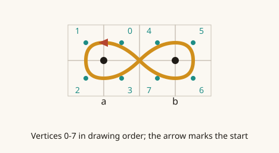
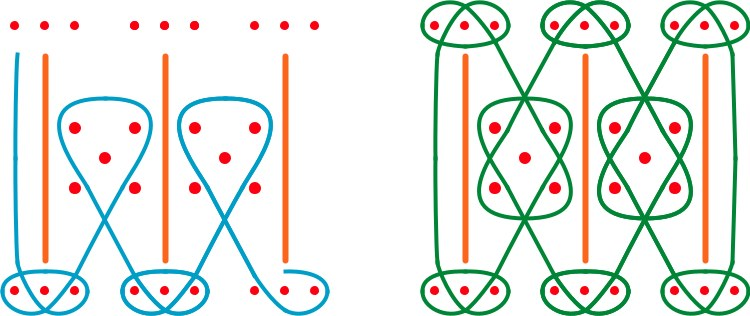
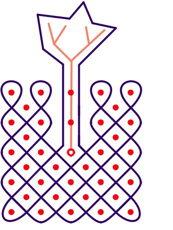
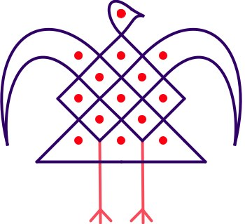
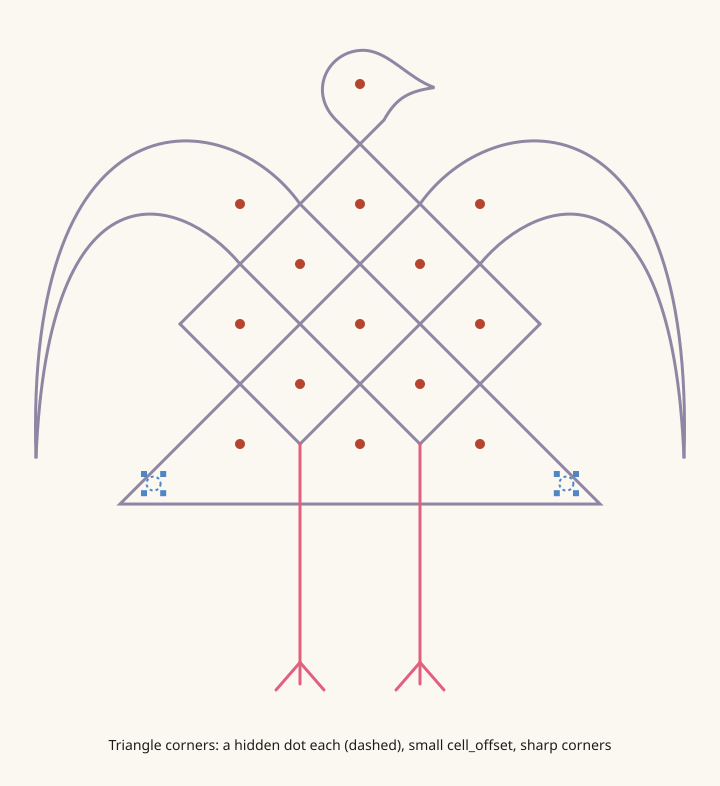
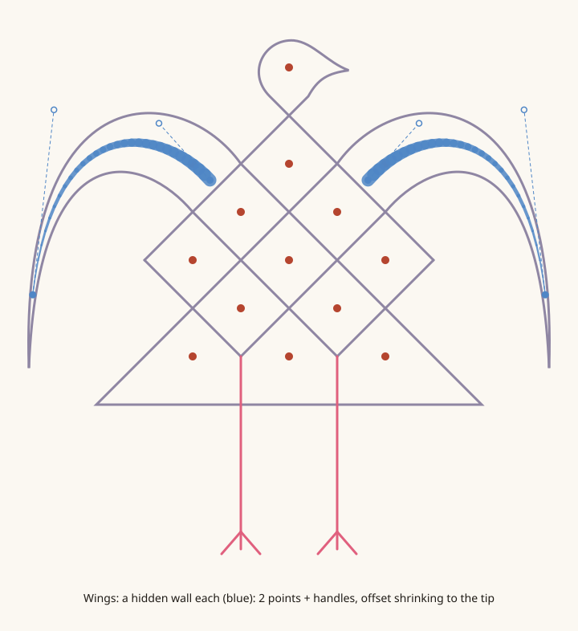
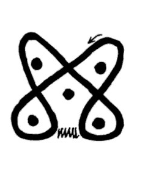

# Specs

## Sona file format, draft 0.1

**Status: v0.1, frozen for testing (November 2026).** No new features until the test files push back; whatever breaks goes into v0.2 with a reason. Schema: [`spec/sona.schema.json`](../src/sona_core/spec/sona.schema.json), in the `sona_core` repo. It's built from [Reflections.md](Reflections.md):

### Principles

1. **Plain JSON, UTF-8, versioned.** Any language can read it with its standard library. File extension: `.sona.json`.
2. **The meaning is stored, never derived:** which dots exist, what each line goes around, in what order, where it starts. Two drawings on the same dots are two different files (Figs. 324/325).
3. **Attached or free: two ways to place a point.** A vertex attached to something (a dot's cell, a dot, a wall, another line) follows it when it moves; a free vertex stays where it's put. Neither carries more meaning than the other: the drawing is all of them together.
4. **No renderer objects.** Separate abstraction from representation.
5. **One drawing, many constructions.** The format doesn't pick one correct way to define a drawing: it exposes **construction techniques** (dots, hidden dots, walls, grids and gates, symmetry, generators), as CAD software does. The same sona can be built with walls or with hidden dots, by hand or by bouncing one path out across a grid. Constructions run **one way**: their inputs are stored, and so is the drawing they produce, so a reader never has to run them. No constraint solving.
6. **Forward-compatible.** Readers must ignore keys they don't know, and editors should keep them when saving. 

### Coordinates

- One unit is the **simple dot**: a regular grid has dots one unit apart. Irregular layouts just use whatever positions they need.
- x goes right, **y goes down** (the screen and SVG convention).
- No fixed canvas: a renderer fits the drawing's bounding box to its output.

### Top level

```json
{
  "format": "sona",
  "version": "0.1",
  "meta":     { ... },
  "dots":     [ ... ],
  "grids":    [ ... ],
  "walls":    [ ... ],
  "paths":    [ ... ],
  "labels":   [ ... ],
  "story":    [ ... ],
  "styles":   { ... },
  "crossings":[ ... ],
  "crossing_style": "sand",
  "symmetry": { ... },
  "reference":{ ... }
}
```

Only `format`, `version`, `dots` and `paths` are required.

### `meta`: what the drawing is, and where it comes from

```json
"meta": {
  "id": "nzambi-fontinha-177",
  "title": { "cjk": "nzambi", "pt": "Deus", "en": "God" },
  "people": ["Cokwe"],
  "region": "Lunda, Angola",
  "sources": [
    { "citation": "Fontinha 1983", "page": "177",
      "meaning": { "en": "God" } },
    { "citation": "Hamelberger 1952", "page": "329" },
    { "citation": "Gerdes 2012, Geometria Sona de Angola", "figure": "173",
      "kind": "redrawing" }
  ],
  "relations": [
    { "type": "variant_of", "target": "ku-tanga-pearson-25" }
  ],
  "authors": ["…"],
  "license": "CC-BY-4.0",
  "notes": "…"
}
```

- `title` and every other human text is a **language map**: keys are language codes (ISO 639: `pt`, `en`, `cjk` for Chokwe, `lch` for Luchazi…). A plain string is allowed and means "language unknown".
- `sources` is a list because **one drawing can be recorded several times with different meanings** (Fig. 318: three collectors, three meanings). Each source can carry its own `meaning`.
- `source.kind`: `field_recording` (Kubik), `collection` (Fontinha, Dos Santos, Pearson), `redrawing` (Gerdes redrawing a collected one), `reconstruction` (Gerdes' Fig. 94), `new` (made in the app).
- `relations[].type`: `reconstructed_from`, `variant_of`, `derived_from`, `same_motif_as` (Fig. 317's rock engraving). `target` is another file's `meta.id` or a URL.

### `dots`

```json
"dots": [
  { "id": "d1", "x": 0, "y": 0 },
  { "id": "d2", "x": 1, "y": 0, "style": "ring" },
  { "id": "d3", "x": 0.5, "y": 2, "hidden": true },
  { "id": "d4", "x": 3, "y": 0, "cell_offset": 0.15 }
]
```

- `id`: any string without `.` or `:` (those build cell IDs), unique in the file across everything that has an ID (dots, grids, walls, paths, vertices). Editors should keep IDs stable across edits (they're referenced everywhere).
- Positions are **free**, always written out, even when a grid made them (see `grids`). Irregular layouts and the denser column (Fig. 126) need nothing special.
- `grid`: the ID of the grid this dot belongs to, if any.
- `hidden`: an invisible point. It still has cells, and the line can go around it; it just isn't drawn.
- `style`: a presentation name: `dot` (default), `ring`, `ringed_dot`, `large`, or a key in `styles`.

#### Cells

Each dot has four cells, named by direction: `NW`, `NE`, `SE`, `SW`. A cell's ID is `<dot id>:<direction>`, e.g. `d12:NE`.

Cell position: `dot + (±k, ±k)`, where **k follows the local spacing**: by default `k = 0.25 × n`, with `n` the distance from this dot to its nearest neighbour. `cell_offset` on a dot overrides k. Because k follows spacing, the half-spaced column in Fig. 126 gets proportionally smaller cells instead of colliding. (The 0.25 is a placeholder: tune it with the reference renderer, then freeze it, because every renderer has to agree.)

### `walls`: lines the line goes around

Gerdes' *linhas auxiliares* (Figs. 122, 198, 174b, 260): lines laid down before the sona line, which the line wraps around and doesn't cross. A wall isn't a path. It's **scaffolding, like the dots**: something that constrains where the line can go. In the mirror-curve model, a wall is a row of mirrors.

Like dots, walls are clearly defined by a few points. **Almost every wall, straight or curved, takes a few points**, described exactly like a path's vertices: the same `shape`s, handles and corners. Software just follows along the curve.

```json
"walls": [
  { "id": "w1", "points": [[1, 0.6], [1, 2], [1, 3.4]], "style": "aux" },
  { "id": "w2", "points": [{ "dot": "d3" }, { "dot": "d7" }], "hidden": true },
  { "id": "wing_l", "hidden": true, "points": [
      { "x": -0.82, "y": 1.17, "cell_offset": 0.3, "shape": "curve", "out": [-0.53, -0.59] },
      { "x": -2.66, "y": 2.36, "cell_offset": 0.02, "in": [0.22, -1.92] } ] }
]
```

- `points`: two or more. Each is a vertex, as in a path: `{ "x", "y" }` (or the shorthand `[x, y]`), or `{ "dot": id }` (the wall starts or ends on a dot, and moves with it). Points can carry `shape`, `in` / `out` handles and `corner`, with the same meanings as for paths. Three points with the default `auto` shape make a quadratic Bézier curve: start, pull, end.
- `shape` on the wall: the default for its points, as for paths.
- `cell_offset` on the wall: how far its cells sit from it (default k, as for dots). **On a point, it overrides the wall's offset there**, so a wall can taper: each point a bit closer than the last, and the last one so close that the line wrapping around it comes to a point. That's the rooster's wing (`wing_l` above: two points with handles, one curve, running between the wing's two arcs).
- `hidden`: an invisible wall. The line still wraps around it, but the wall isn't drawn: a pure construction aid, and a pure mirror, which is what a mirror-curve generator writes.
- `style`: presentation, as for paths.
- **Drawing order:** walls are drawn after the dots and before the paths, in list order (Fig. 122 draws them first).
- Walls aren't paths, so they're **never counted in linearity**.

#### Wall cells

A wall gives the line cells the same way a dot does. Each wall point has a cell on each side; the two tips also have one past the end:

| Cell | Where |
|---|---|
| `w1.2:L` | Left of wall point 2, looking along the wall from point 0 to the last |
| `w1.2:R` | Right of wall point 2 |
| `w1.0:E`, `w1.<last>:E` | Past the tip, along the wall's direction |

A cell sits beside the point's place on the drawn wall (its anchor: for an `auto` point, the nearest point of the curve, as for paths), at that point's offset, at right angles to the wall. **Need more places to pass beside a long wall? Add points to the wall.** They cost nothing, and they're scaffolding, like dots.

A checker warns when a path crosses a wall.

### `grids`: regular layouts, and where mirrors can go

Many sona sit on regular grids, and the mirror-curve family (Gerdes, Jablan; kolam too) is generated from them. A grid stores the layout and its mirrors. **The algorithms that fill a grid with lines are tools, not format**: they write ordinary paths.

```json
"grids": [
  { "id": "g1", "origin": [-1, 1], "spacing": 1, "rows": [3, 2], "cols": [3, 2],
    "gates": [
      { "between": ["a1", "b1"], "mirror": "join" },
      { "between": ["c3", "d2"], "mirror": "split" }
    ] }
]
```

- `rows`, `cols`: one number for a plain grid. Two numbers for **two interleaved grids**, Gerdes' mat patterns: the first grid's top-left dot is at `origin`, and the second is offset by half a spacing in x and y. The rooster's body above is `rows: [3, 2], cols: [3, 2]`; Gerdes' classes A–D are just different pairs.
- `spacing`: distance between neighbouring dots of one grid. `angle` (degrees, default 0) for a tilted grid.
- **The dots are still written out in `dots`**, each with `"grid": "g1"`, so a reader that knows nothing about grids loses nothing (same idea as `symmetry`). Holes and missing dots are simply dots that aren't there. The grid's members are the dots that name it.
- **Gates are computed, not listed:** a gate is the midpoint between two **nearest neighbours** of the grid. In a plain grid that's left/right and up/down neighbours; in interleaved grids it's the diagonal neighbours.
- `gates` lists only the gates that hold a mirror. Every other gate is a **crossing**, the default. A mirror is a hidden wall in short form, and the core expands it into one:
  - `join`: a wall from one dot to the other. The line can't pass between them.
  - `split`: a short wall across the gap, at right angles to it. The line passes between them twice without crossing itself.
- The grid's border always acts as a mirror: lines bounce back at its edge.

**How a generator uses it:** a mirror-curve tool reads the grid and its gates, then writes the paths, marking each with `"made_with": { "tool": "mirror_curve", "grid": "g1" }` on the path. Flipping a gate in the editor changes one entry in `gates`, then the tool rewrites the paths it made. If the user edits such a path by hand, the editor drops its `made_with`, and from then on it's an ordinary drawn path.

### `paths`

A sona is a set of paths. A path is an ordered list of vertices.

```json
{
  "id": "p1",
  "role": "line",
  "closed": true,
  "shape": "auto",
  "vertices": [ ... ],
  "caps": { "start": "none", "end": "none" },
  "style": "main",
  "layer": "lines",
  "label": { "en": "the river" }
}
```

- `role`:
  - `line`: the sona line itself. Counted for linearity.
  - `extra`: strokes added to the figure that don't constrain the line: legs, tails, necks, bars, spines, the tree's trunk and twigs. **Drawn, but not counted.** (Walls the line goes around aren't paths: see `walls`.)
  - `glyph`: small standalone pictographs (Fig. 173's bays, Mubitana's *chingelengele*).
  - `guide`: editor-only construction, never rendered.
- `closed`: a closed loop or an open stroke. Open strokes are normal, even in geometric sona (Fig. 325).
- **Order matters twice:** the order of `paths` is the drawing order, and each path is drawn from its first vertex, in vertex order. So the start point and direction are just "vertex 0, then onwards". Kubik's tortoise (two oblongs, then the square, then the head and legs) is simply that order of paths.
- `shape`: the default `shape` for every vertex of this path (below). A vertex's own `shape` overrides it. A mostly straight line (a mat pattern) says `"shape": "straight"` once instead of on every vertex.
- `layer`: `lines` (default), `symbols`, `annotations`. Purely for editing and visibility toggles.

#### Vertices: bound or free

Each vertex is exactly one of these:

| Kind       | JSON                                           | Meaning                                                                                                                                                                    |
| ---------- | ---------------------------------------------- | -------------------------------------------------------------------------------------------------------------------------------------------------------------------------- |
| Cell       | `{ "cell": "d12:NE" }`, `{ "cell": "w1.2:L" }` | The line passes through this cell of dot d12, or beside point 2 of wall w1. The normal weaving vertex                                                                      |
| Dot centre | `{ "dot": "d12" }`                             | On the dot itself: strokes through dots (Fig. 91a), ending on dots (Kubik/Mubitana)                                                                                        |
| On a line  | `{ "on": { "vertex": "v5", "t": 0.4 } }`       | On another path, at a line position (below): 40% of the way from vertex v5 to the next one. T-junctions, legs growing from a body, branches (Figs. 138, 174b) (rare cases) |
| Free       | `{ "x": 2.3, "y": -1.1 }`                      | Just a position: big sweeps, necks, wings, caps. The "bag of invisible points"                                                                                             |

Optional keys on any vertex. The first two are about the vertex itself; the rest describe **the segment leaving it**, from this vertex to the next one:

```json
{ "cell": "d3:NE", "shape": "straight" },
{ "x": 2.3, "y": -1.1, "corner": "sharp" },
{ "cell": "d7:SW", "stroke": "zigzag" }
```

- `"corner": "sharp"`: the curve makes a rugged turn here instead of passing smoothly.
- `"in": [dx, dy]`, `"out": [dx, dy]`: tangent handles, relative to the vertex, like in a font editor. `out` shapes the segment leaving this vertex, `in` the one arriving.
- `shape`: how the line travels to the next vertex.
  - `auto`: the default. A smooth curve computed from the neighbours. Reference rule: the vertex positions are the control points of a quadratic B-spline, so closed loops come out smooth with no special cases; a `sharp` vertex is on-curve.
  - `straight`: a straight run.
  - `curve`: a cubic Bézier using this vertex's `out` and the next vertex's `in` handles.
  - `miter`: a sharp V. The line arriving at this vertex keeps going straight, the line leaving the next vertex is extended backwards, and the two meet in a point. That's the bounce at the edge of a mat pattern: the route only says "around this dot" (`d1:SW` -> `d1:SE`), and the V comes from the straight runs on either side. Both ends stay bound to cells, so the V follows the dots. If the two lines don't meet ahead of the vertices (parallel or diverging), it falls back to `straight`.
- `stroke`: how that segment is drawn, as presentation: `solid` (default), `zigzag` (*hambelo*'s barred entrance), `dashed`, `double`. The route is unchanged.
- In a closed path, the last vertex's segment goes back to vertex 0. In an open path, the last vertex has no outgoing segment, so `shape` and `stroke` there are ignored (a checker warns).
- Most vertices carry none of these keys: the default is the path's `shape` (itself `auto` by default) and a solid stroke.

Segments live on the vertices, not in a separate list, so inserting or deleting a vertex never renumbers them, and you can read a line's look where you read its route.

#### Vertex IDs and positions on a line

Anything that points *into* a line (a junction, a label, a story beat, a crossing override) points at a **vertex ID**, never at a vertex's index (since that can change). Inserting or deleting vertices then never breaks a reference.

- `id` on a vertex: unique in the file, in the same namespace as dots, walls and paths. Optional for hand-written files, but **any vertex something points at must have one**. Editors give every vertex an ID and never reuse one. Short is fine: `"v17"`, or a name when it means something: `"fork"`, `"beak"`.
- A **line position** is `{ "vertex": "v5" }` or `{ "vertex": "v5", "t": 0.4 }`: on the drawn line at vertex v5, or 40% of the way, by length along the drawn line, from v5 to the next vertex. The path is implied, since vertex IDs are unique.
- **A position always lands on the drawn line.** A vertex's place on the line (its *anchor*) is:
  - the vertex itself if the line passes through it: `sharp` vertices, the ends of `straight`, `curve` and `miter` segments, and the first and last vertex of an open path (the line starts and ends exactly there);
  - for an `auto` vertex, which is only a control point the line bends towards: the point of the curve nearest to it. With the reference rule, that's the middle of its curve piece, `(m₁ + 2v + m₂) / 4`, where m₁ and m₂ are the midpoints with its neighbours.
- If a vertex that something points at is deleted, the editor has to move or remove the reference. A checker reports dangling ones.

`made_with`: optional memory of the editor tool that wrote some vertices (curl, horn, cap, wave…), so the editor can keep them editable as one shape. It sits on the first vertex the tool wrote, with `count` for how many: `"made_with": { "tool": "curl", "size": 0.3, "count": 5 }`. **Readers draw from the stored vertices and ignore this.** New shapes never need a new format feature. On a **path** (no `count`), it means a tool wrote the whole path, e.g. a mirror-curve generator (see `grids`).

#### End caps (open paths only)

`caps.start` / `caps.end`: `none` (default), `arrow`, `fletching` (Fig. 165), `fork` (Figs. 39, 45a), `knob` (the sand tree), `diamond`, `triangle`, `hook`, `ring` (Fig. 174a's top). Anything else is drawn as small paths with role `extra` or `glyph`.

### Linearity (computed, never stored)

The number of connected paths with `role: line`. Paths joined by `on` vertices count as one figure. Walls and `extra` strokes never count, so "monolinear (not counting the auxiliary lines)", as Gerdes puts it, is simply the count.

### Crossings (computed; optional overrides)

Crossings are found geometrically and are not stored. By default, **the stroke drawn later is on top**, as in sand (Torday & Joyce, Fig. 56). Overrides are for interlace styles like the rock engraving in Fig. 317b:

```json
"crossings": [
  { "a": { "vertex": "v4", "t": 0.5 }, "b": { "vertex": "v11", "t": 0.5 }, "over": "a" }
],
"crossing_style": "interlace"
```

`crossing_style`: `sand` (default: later on top, no gaps), `interlace` (alternate over/under, with gaps), `flat` (no over/under at all).

### `labels`: names/figures on dots, lines and regions

```json
"labels": [
  { "target": { "dot": "d7" },  "text": { "en": "the hunter" } },
  { "target": { "vertex": "head" }, "text": { "lch": "mutwe", "en": "head" } },
  { "target": { "region": { "x": 2, "y": 1.5 } }, "text": { "lch": "tundanda", "en": "initiates" } }
]
```

A **region** is the area enclosed by the lines that contains the given point (or dot: `{ "region": { "dot": "d5" } }`). It's computed when needed, so it survives edits as long as the point stays inside (Mukanda's enclosures).

### `story`: text and voice tied to the drawing

```json
"story": [
  { "at": { "vertex": "start" }, "text": { "en": "This is the pen of the goats." } },
  { "at": { "vertex": "gate", "t": 0.5 }, "text": { "en": "Then the boy goes to lock them in…" },
    "audio": "audio/lock.ogg" },
  { "at": { "vertex": "end" }, "text": { "lch": "Kelekeche!" }, "pause": 1.5 }
]
```

Story beats are tied to **line positions** (see "Vertex IDs and positions on a line"), not to seconds. Any animation speed or style shows the text when the line reaches that point. `audio` paths are relative to the file (a `.sona.zip` bundle can hold the audio; see open questions).

*(Note to self, for the implementation: an easy way to handle this would be to generate the ElevenLabs narration first, then fit the timing to how the drawing is being drawn. ElevenLabs can even return per-word timestamps, iirc.)*

### `styles`: named, portable presentation

```json
"styles": {
  "main":  { "color": "#2b1a4a", "width": 0.06 },
  "aux":   { "color": "#e87722", "width": 0.05 },
  "ring":  { "kind": "dot", "shape": "ring", "size": 0.12 }
}
```

Colours are CSS hex strings, widths are in drawing units. Renderers are free to ignore all of it (a brush-stroke animation won't care about colour).

### `symmetry` (an editor/generator hint)

```json
"symmetry": { "type": "rotation", "order": 4, "center": [4, 4] }
```

The file always stores the **fully expanded drawing**, so a reader never needs to know about symmetry (principle 5: constructions run one way). The hint lets an editor or generator keep the copies in sync. Types: `rotation` (with `order`), `mirror` (with `axis: [[x1,y1],[x2,y2]]`), or a list of both.

*(Note to self, migrate to Reflections later: symmetry, gates, algorithms, etc. can be used as features of the UX. We should not assume the user will hand-draw the whole thing every time. Giving them tools to quickly define and generate what they want, including in parts, is probably easier. For example, letting the user start one path and then "bounce it out" to fill the whole thing would be very satisfying UX, in my opinion.)*

### `reference` (optional)

```json
"reference": { "image": "photo.jpg", "transform": [1, 0, 0, 1, 0, 0], "opacity": 0.5 }
```

The scanned photo behind the drawing (scanning step 7: the user corrects the result over the photo).

---

## Example: the figure-eight around two dots

Two dots, one closed line, every vertex a cell.



*Rendered from this file by `images/make_diagrams.py`. The furthest the old app got was the same drawing: [`first_loop_3_smoothed.png`](../prior_work/sona_maker_screenshots/first_loop_3_smoothed.png).*

```json
{
  "format": "sona",
  "version": "0.1",
  "meta": { "id": "figure-eight", "title": { "en": "Figure eight" }, "sources": [{ "kind": "new" }] },
  "dots": [
    { "id": "a", "x": 0, "y": 0 },
    { "id": "b", "x": 1, "y": 0 }
  ],
  "paths": [
    { "id": "p1", "role": "line", "closed": true,
      "vertices": [
        { "cell": "a:NE" }, { "cell": "a:NW" }, { "cell": "a:SW" }, { "cell": "a:SE" },
        { "cell": "b:NW" }, { "cell": "b:NE" }, { "cell": "b:SE" }, { "cell": "b:SW" }
      ] }
  ]
}
```

Easy one, huh?

`a:SE -> b:NW` and `b:SW -> a:NE` both pass between the dots, so they cross there: that's the crossing of the eight, found geometrically.

Other ways to build the same file:
- **By hand:** as above, eight cells in order.
- **Grid + generator:** a 1×2 grid with no mirrors. The mirror-curve tool bounces the line off the border and writes this exact path, tagged `made_with: mirror_curve`.
- **Symmetry:** draw the loop around `a`, declare a mirror between the dots, and let the editor write `b`'s half.

## Example fragments for the hard cases

**A wall the line wraps around** (Fig. 122):



*Gerdes, Geometria Sona de Angola, Fig. 122: the orange walls are drawn first (left), then the line wraps around them (right). The fragment below is one wall, simplified.*

There are multiple ways to define this drawing. You could use auxiliary lines (walls):
```json
"walls": [ { "id": "w1", "points": [[1, 0.6], [1, 2], [1, 3.4]] } ]
```

The line goes down its left side, around the bottom tip and back up the right, using the wall's cells like any dot's:
```json
{ "cell": "w1.0:L" }, { "cell": "w1.1:L" }, { "cell": "w1.2:L" },
{ "cell": "w1.2:E" },
{ "cell": "w1.2:R" }, { "cell": "w1.1:R" }, { "cell": "w1.0:R" }
```

But if you're not worried about including the auxiliary lines, you could quite literally just use 2 hidden points.

*(Note to self: the auxiliary lines here exist for the convenience of the original sand drawers. We shouldn't necessarily aim to represent every drawing the way it was originally done, given the convenience we get from digital tools. Think about how AutoCAD and the like are developed: much wisdom can be extracted from CAD software here. Walls, symmetry, etc. are not just features of the drawing, they're also construction techniques.)*


**A stroke over dots that forks** (Fig. 91a):



*Gerdes, Geometria Sona de Angola, Fig. 91a (Dos Santos p. 103): a miyombo, the cult tree. Dos Santos says these sona show "the sticks of the tree with branches and leaves". The light stroke is the stick: it starts on the ringed dot, passes over the two dots above it, then forks.*

The three dots of the stick (the dark woven line around them is left out here). Units are dot spacings, with y going down. The other dots form two interleaved grids, like the rooster's: one at whole positions (the stick's dots are on it), and one offset by half in both directions, e.g. `{ "x": 0.5, "y": 0.5 }`, `{ "x": 1.5, "y": 2.5 }`:
```json
"dots": [
  { "id": "ring",  "x": 2, "y": 2, "style": "ring" },
  { "id": "stem1", "x": 2, "y": 1 },
  { "id": "stem2", "x": 2, "y": 0 }
]
```
The stick is one stroke. It passes **over** the dots, so its vertices are dot centres (`{ "dot": … }`), not cells. Above the dots, the fork and the branch tip are free vertices:
```json
{ "id": "stick", "role": "extra", "closed": false,
  "vertices": [ { "dot": "ring" }, { "dot": "stem1" }, { "dot": "stem2" },
                { "id": "fork", "x": 2, "y": -1.1, "corner": "sharp", "shape": "straight" },
                { "x": 1.35, "y": -2.3 } ] }
```
The fork is `sharp` because the drawing has a corner there. It has an ID because the other branch starts **on** it, and so moves with the stick when the stick is edited:
```json
{ "id": "branch2", "role": "extra", "closed": false,
  "vertices": [ { "on": { "vertex": "fork" } }, { "x": 3.25, "y": -2.2 } ] }
```
The small twigs on each branch work the same way: `on` the branch, then a free vertex.

Another construction: the stick as a **wall** through the three dots (`points` on `ring`, `stem1`, `stem2`, then on to the fork), with the branches as more walls meeting it. The dark line wraps around it the same way. Here it's an `extra` stroke because it's drawn and it's what the sona depicts, but both files draw the same thing. (Walls that meet are still an open question.)

**The rooster: wings far from the dots, straight and curved in one line** (Fig. 45a):



*Gerdes, Geometria Sona de Angola, Fig. 45a (Dos Santos p. 52): ndemba kasúmbi, a rooster. A mat pattern (straight diagonals) for the body, a head with a beak, two wings that sweep far from any dot, a triangle under the body, and legs (pink) that Gerdes colours apart from the line.*

There are many ways we could define this drawing. The body is easy: it's just a regular grid with a mat pattern. The challenge is the bottom (the pointy ends far from the dots, on the left and right), the wings, and the head.

**Construction with hidden dots and walls.** For the bottom, one thing we could do is define 2 invisible points with sharp (rough) corners, and perhaps reduce their offset to get a sharper transition:



For the wings, we could use auxiliary lines (walls):



The auxiliary line could get smaller and smaller instead of being a straight path: a bunch of points, each with a smaller offset than the last, and the last one so small you get a pointy shape. That's a tapered wall (`wing_l` in the `walls` section).

**Construction with free vertices and handles.** The same rooster, done the other way, in detail:


The dots (measured from the image, so approximate). They're two interleaved grids: rows `a`, `c`, `e` at whole positions, rows `b`, `d` offset by half. The head dot `h` sits on top:
```json
"dots": [
  { "id": "h",  "x": 0,    "y": 0 },
  { "id": "a1", "x": -1,   "y": 1 },   { "id": "a2", "x": 0,   "y": 1 },   { "id": "a3", "x": 1, "y": 1 },
  { "id": "b1", "x": -0.5, "y": 1.5 }, { "id": "b2", "x": 0.5, "y": 1.5 },
  { "id": "c1", "x": -1,   "y": 2 },   { "id": "c2", "x": 0,   "y": 2 },   { "id": "c3", "x": 1, "y": 2 },
  { "id": "d1", "x": -0.5, "y": 2.5 }, { "id": "d2", "x": 0.5, "y": 2.5 },
  { "id": "e1", "x": -1,   "y": 3 },   { "id": "e2", "x": 0,   "y": 3 },   { "id": "e3", "x": 1, "y": 3 }
]
```

Below are pieces of the one dark line, in drawing order within each piece. (The full traversal isn't traced here.) The line is mostly straight, so the path says it once:
```json
{ "id": "line", "role": "line", "closed": true, "shape": "straight", "vertices": [ ... ] }
```
Vertices below only carry a `shape` where it differs.

**1. The body is straight.** In a mat pattern, a straight diagonal passes several dots on the same side, so it runs through their cells in a row, and the cells line up:
```json
{ "cell": "b1:NE" },
{ "cell": "a1:NE", ...
```
At the edges, the line turns back around a dot in a sharp V. Under `d1`, it comes down past `c1` and `d1`, bounces between `e1` and `e2`, and goes back up past `d1` and `c2`:
```json
{ "cell": "c1:SW" },
{ "id": "v_d1", "cell": "d1:SW", "shape": "miter" },
{ "cell": "d1:SE" },
{ "cell": "c2:SE" }
```
The V's point is where the two straight runs meet. Its exact depth depends on the cell offset k, so it's one of the things to check when k is tuned.

**2. The left wing: one excursion far from the dots, with no dot inside.** The line leaves the body at `a1:NE`, sweeps up and out to the wing tip, turns sharply, and comes back in at `a1:SW`. That's three vertices and two `curve` segments; the handles give the arcs:
```json
{ "cell": "a1:NE", "shape": "curve", "out": [-0.7, -0.7] },
{ "x": -2.7, "y": 3.1, "corner": "sharp", "in": [-0.05, -2.5], "out": [0.05, -1.8], "shape": "curve" },
{ "cell": "a1:SW", "in": [-0.5, -0.5] },
{ "cell": "b1:SW", ...
```
- **Attached where it should follow:** the wing leaves and rejoins at real cells, so dragging `a1` drags the wing's root.
- **Free where it's art:** the tip and the arcs' shape are a free vertex plus handles. The alternative is `auto` segments through four or five free vertices along each arc. Handles take fewer points; free vertices are easier to drag on a phone. Both are valid files.
- **Free vertices are one way to make the wing; a tapered wall inside it is another** (above). Both are valid files (principle 5).

**3. The head: around one dot, with a beak.** Cells of `h`, `auto` (smooth, overriding the path's `straight`), and one free sharp vertex for the beak:
```json
{ "cell": "h:SW", "shape": "auto" }, { "cell": "h:NW", "shape": "auto" }, { "cell": "h:NE", "shape": "auto" },
{ "x": 0.55, "y": 0.03, "corner": "sharp", "shape": "auto" },
{ "cell": "h:SE" }
```

**4. The triangle: straight runs to corners far from the dots.** The sides continue the body's diagonals. The two bottom corners are free and sharp, and the base is a straight run under the bottom row:
```json
{ "cell": "d1:NW" }, { "cell": "e1:NW" },
{ "x": -2.03, "y": 3.53, "corner": "sharp" },
{ "x": 2.05, "y": 3.53, "corner": "sharp" },
{ "cell": "e3:NE" }, { "cell": "d2:NE" }
```
The base is free (art), but it still closes the triangle under `e1`–`e3`: a region query finds them inside it.

**5. The legs: easy.** Two `extra` paths starting `on` the line at the bottom corners of the woven part (the V under `d1` from section 1, halfway along its `miter` segment), ending in `fork` caps:
```json
{ "id": "leg_l", "role": "extra", "closed": false, "caps": { "end": "fork" }, "style": "legs",
  "vertices": [ { "on": { "vertex": "v_d1", "t": 0.5 } }, { "x": -0.5, "y": 4.6 } ] }
```

**What the rooster exposed:**

- **Bounce corners sit between dots, not on cells.** The V's point is in the gap between `e1` and `e2`, not at any cell, so it needed a free vertex that wouldn't follow the dots. **Decided:** the `miter` segment shape.
- **A mostly straight line repeated `"shape": "straight"` on almost every vertex.** **Decided:** `shape` on the path sets the default.
- **Two cells can name the same passage.** In section 1 the diagonal passes between `a2` and `b1`, close to `a2:SW` and `b1:NE` alike. So two files could describe the same line with different cells. That's fine: one drawing, many files (principle 5). A comparison or search tool just has to treat them as the same gate.

**The barred entrance** (*hambelo*):



*Kubik, Tusona p. 38: limba lyavamphembe, the pen of goats.*

Ways to build the zigzag:
- **As presentation:** the closed route as usual, plus `"stroke": "zigzag"` on the vertex where the entrance starts. The line's route doesn't change.
- **As points:** the zigzag written out as free `sharp` vertices along the entrance, tagged `made_with: { "tool": "zigzag", "count": … }` so it stays editable as one zigzag.
- **As its own stroke:** a short `extra` path laid across the entrance, if it was drawn as a separate gesture.

## Edge cases → features

Most rows have more than one construction (principle 5).

| Edge case ([EdgeCases.md](EdgeCases.md)) | Ways to build it |
|---|---|
| Same dots, different lines (324/325, 326/327) | Paths are stored, never derived. By hand, or a grid with different gates |
| Straight and curved in one line (324) | `shape` on each vertex, for the segment leaving it |
| Curls with no dot inside (324) | Free vertices (`made_with: curl` keeps it editable); or a `hidden` dot inside, the line going around its cells |
| Petals around one far dot (326) | Cells of that dot; or free vertices shaped around it |
| Hammer-head caps, arched caps (327, 324) | Free vertices + `straight` segments + `sharp` / handles; or a short `hidden` wall the line wraps |
| Big sweeps far from dots (cadeira, stork) | Free vertices, `hidden` dots, or `hidden` walls: whichever construction suits |
| Horns, leaf tips | Free vertex with `corner: sharp`; a `hidden` dot with a tiny `cell_offset`; or a tapered `hidden` wall |
| Open lines, snakes with curled ends (325) | `closed: false`; the curl as free vertices, or around a `hidden` dot |
| Legs, necks, tails, bars | Paths with role `extra`, starting `on` the body (Fig. 45a) |
| Wings and sweeps far from dots, mat bodies with sharp bounces (45a) | A tapered hidden wall, or free vertices + `curve` handles; hidden dots with small offsets for far corners; `miter` for bounces |
| Marked dot (324 centre, 231a) | Dot `style` |
| 4-fold symmetry | Drawn out in full; or one quarter + `symmetry`; or a grid + generator. Stored expanded either way |
| Auxiliary walls (122, 198, 174b, 260) | `walls` (visible, as drawn); or `hidden` dots where the line turns, if the walls themselves don't matter |
| Regular and mat-pattern sona, mirror curves, kolam | `grids` with sparse `gates`; generators write ordinary paths |
| Lines through / ending on dots (91a, Mubitana) | `dot` vertices; or a wall through the dots |
| T-junctions, branching (138, 91a) | `on` vertices |
| Standalone glyphs (173, *chingelengele*) | Role `glyph`, layer `symbols`, `label` |
| Over/under (Fig. 56 sand, 317b engraving) | Derived from drawing order; `crossings` overrides + `crossing_style` |
| Denser dot column (126) | Free dot positions (cell offset follows local spacing); or a second grid |
| End decorations (165, 39, sand tree) | `caps` |
| *Hambelo* zigzag | `stroke: zigzag`; or free sharp vertices (`made_with: zigzag`); or its own `extra` path |
| Recorded vs reconstructed; one drawing, many meanings (93/94, 260/261, 318) | `meta.sources[]`, `meta.relations[]` |
| Named parts, characters as dots (Mbambi, hunter and dog) | `labels` on dots, paths, regions |
| Drawing order, start point, direction (Kubik) | Path order + vertex order |
| Stories with voice-over | `story` tied to positions along paths |
| Textured tusona (Ngandu) | Out of scope. `stroke` could get `multi` later at most |

## Open questions

1. **Walls.**
   - **Gerdes' term:** does *linha auxiliar* cover only walls, or also the extra strokes (legs, trunks)? If only walls, the `extra` role needs a better name.
   - **Tapering:** is a per-point `cell_offset` enough for the rooster's wings, or does it need the offset to vary smoothly along the wall? Check when it renders.
   - **Merging walls:** Fig. 198's walls meet each other. Do two walls share a point, or is that one branching wall?
2. **Cell offset constant.** 0.25 × nearest-neighbour distance is a guess. Tune it on real sona with the reference renderer, then freeze it.
3. **Bundles.** Audio and reference photos: a `.sona.zip` holding `sona.json` plus media? Keeps sharing offline-friendly (one file).
4. **Language codes** for Chokwe (`cjk`), Luchazi (`lch`), Ngangela: check with the owner what speakers would expect.
5. **Partial-stroke timeline.** If a drawer stops halfway through one line, draws something else, then continues (does Kubik record this?), path order isn't enough and an explicit `timeline` list is needed.
6. **Grids.**
   - **Mirror names:** `join` / `split` are placeholders. Check what Gerdes and Jablan call the two orientations.
   - **Other lattices:** triangular and hexagonal kolam grids. Add a `kind` later if they're needed.
   - **Grid-to-dot drift:** a dot of the grid dragged off its grid position. Is it still a member? (Probably yes: membership is the `grid` tag, not the position.)
7. **Stable references across regeneration** (CAD's "topological naming problem"; see [Reflections.md](Reflections.md), "What CAD teaches"). When a generator rewrites its paths (a gate flipped), vertex IDs that other things point at can vanish: the rooster's legs attach to `v_d1` on the generated body. Proposed: generators write deterministic vertex IDs from their inputs (cell + visit count), and attachments prefer stable targets (dot cells) over generated vertices.
